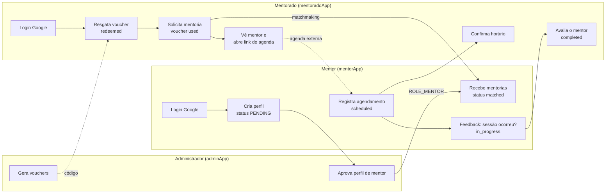
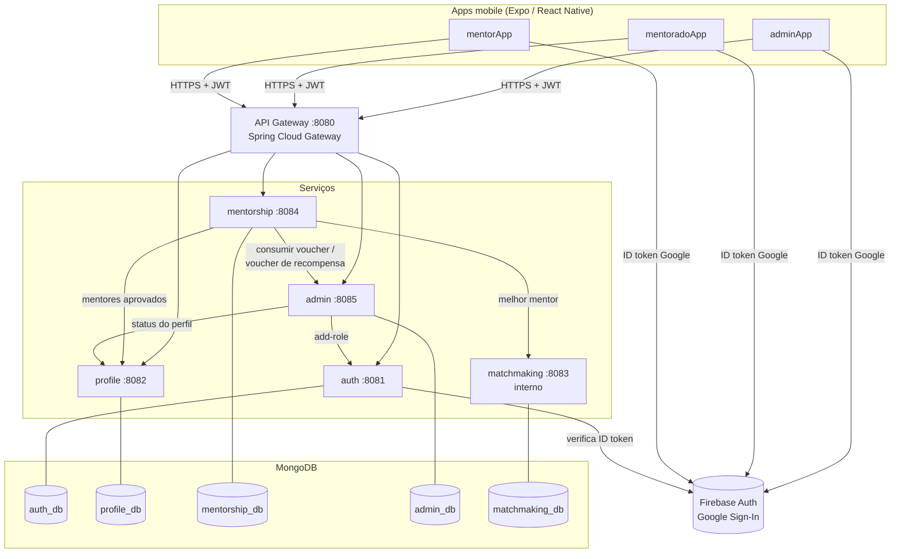
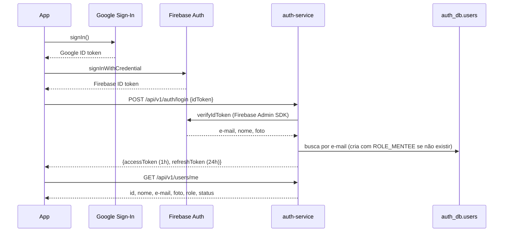
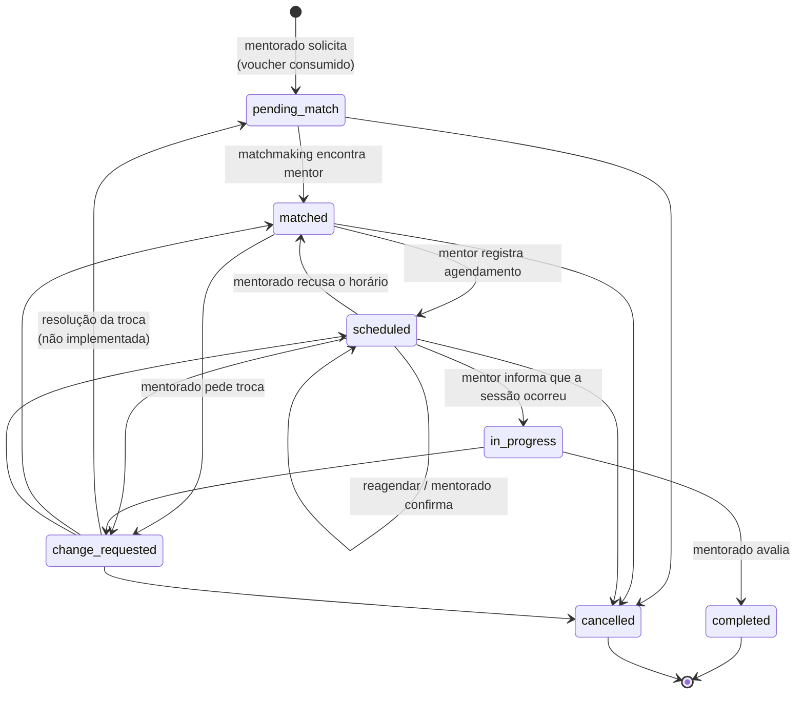
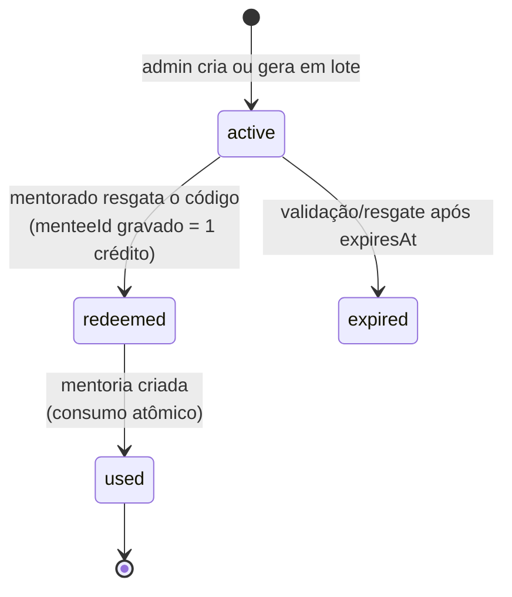
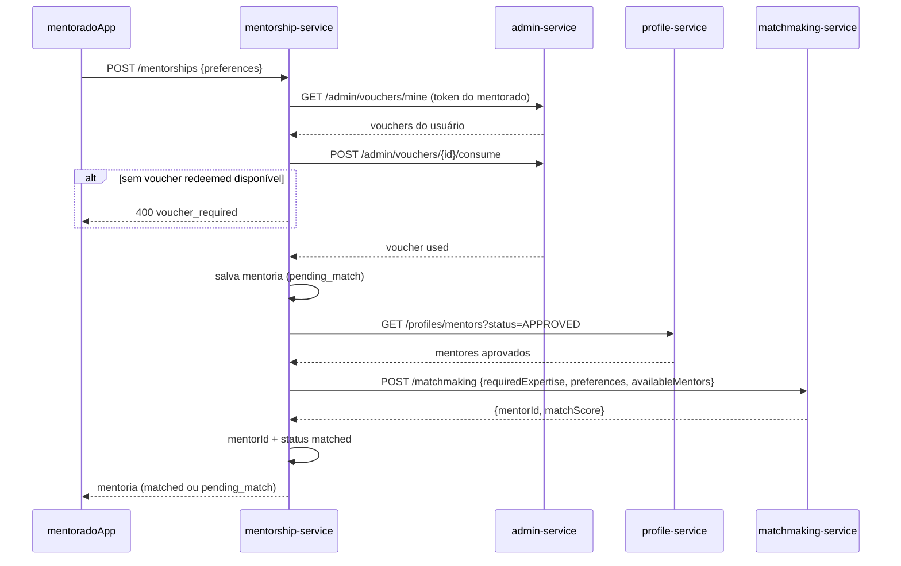
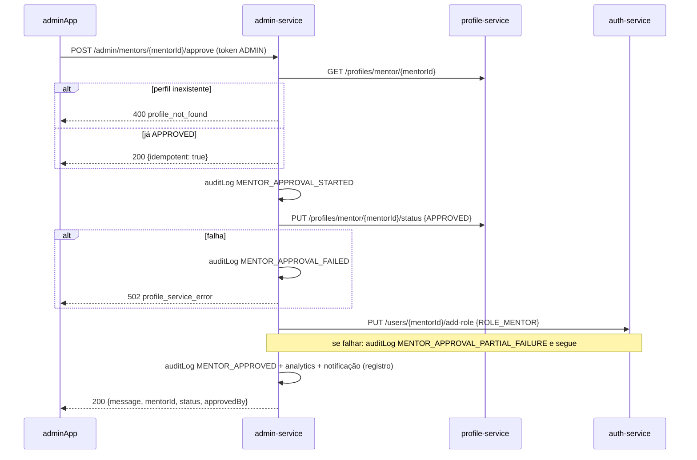
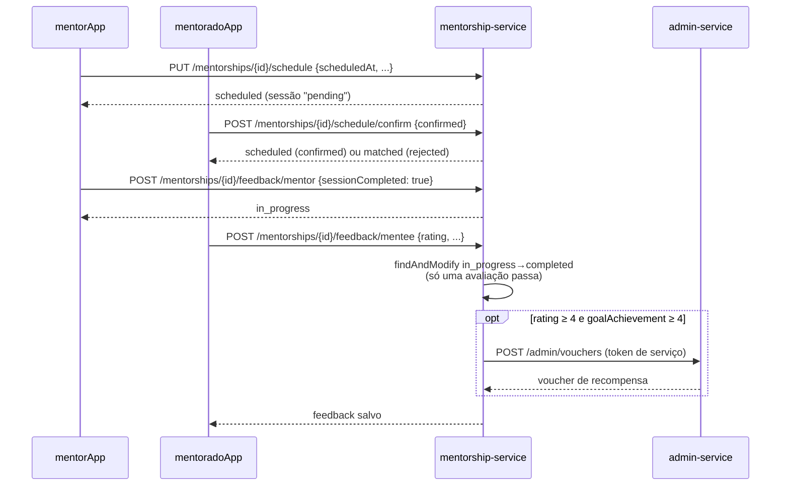

# UberHub Mentorias — Documentação do Projeto

[Plano de implementação](https://spi-ce-2026.github.io/.github/) | [Política de Desenvolvimento em Equipe](https://docs.google.com/document/d/16muCiPGo4BYB7aT1GkjzMVyVIujAr7cUlV4XgSh12R4/edit?usp=sharing)

O UberHub Mentorias conecta mentorados a mentores por meio de vouchers e matchmaking por tags. O sistema tem 6 serviços Spring Boot atrás de um API Gateway e três apps React Native: o do mentorado, o do mentor e o do administrador. Cada app React Native tem o próprio repositório na organização `spi-ce-2026` ([seção 3](#repositórios)). O login é feito com Google via Firebase, e o backend emite o próprio JWT.

Este documento descreve o sistema **como ele está implementado hoje**. O backend está completo. Os apps são um *starter*: o login e a navegação base estão prontos, e as telas de cada funcionalidade são implementadas pelas equipes ([seção 9](#9-apps-mobile)). Onde a especificação original diverge do código, a divergência está indicada. Em caso de conflito, a ordem de precedência é: **código > este documento > documentos antigos**.

## Índice

1. [Visão geral do produto](#1-visão-geral-do-produto)
2. [Jornadas e fluxo de ponta a ponta](#2-jornadas-e-fluxo-de-ponta-a-ponta)
3. [Arquitetura](#3-arquitetura)
4. [Autenticação e autorização](#4-autenticação-e-autorização)
5. [Serviços do backend](#5-serviços-do-backend)
6. [Ciclos de vida (status)](#6-ciclos-de-vida-status)
7. [Fluxos detalhados](#7-fluxos-detalhados)
8. [Requisitos e regras de negócio](#8-requisitos-e-regras-de-negócio)
9. [Apps mobile](#9-apps-mobile)
10. [Ambiente de desenvolvimento](#10-ambiente-de-desenvolvimento)
11. [Testes](#11-testes)
12. [CI/CD e deploy](#12-cicd-e-deploy)
13. [Operação e solução de problemas](#13-operação-e-solução-de-problemas)
14. [Segurança](#14-segurança)
15. [Processo de trabalho](#15-processo-de-trabalho)
16. [Limitações conhecidas e próximos passos](#16-limitações-conhecidas-e-próximos-passos)
17. [Glossário](#17-glossário)

## 1. Visão geral do produto

**Problema.** Quem quer orientação profissional não sabe quem procurar, e quem quer ser mentor não encontra quem precisa. Hoje a conexão depende de sorte e indicação e não escala.

**Solução.** Uma plataforma em que:

- o **administrador** distribui vouchers e aprova mentores;
- o **mentorado** resgata um voucher, descreve sua necessidade (tags) e recebe automaticamente o mentor mais compatível;
- o **mentor** agenda a sessão em ferramenta externa (ex.: Google Calendar), registra o agendamento no app e informa se a sessão aconteceu;
- o **mentorado** avalia o mentor e a mentoria é concluída.

**Contexto.** Projeto acadêmico do IFTM com o UberHub (ecossistema de inovação). É desenvolvido por equipes de estudantes em sprints Scrum (ver [seção 15](#15-processo-de-trabalho)). O código é aberto (licença MIT).

### Atores

| Ator | Cliente | O que faz | Papel no sistema |
|---|---|---|---|
| Mentorado | [`spi-ce-2026/mentorado`](https://github.com/spi-ce-2026/mentorado) | Resgata voucher, solicita mentoria, vê o mentor, confirma horário, avalia | `ROLE_MENTEE` |
| Mentor | [`spi-ce-2026/mentor`](https://github.com/spi-ce-2026/mentor) | Cria perfil, aguarda aprovação, registra agendamento, dá feedback da sessão | `ROLE_MENTEE` + `ROLE_MENTOR` (após aprovação) |
| Administrador | [`spi-ce-2026/administrador`](https://github.com/spi-ce-2026/administrador) | Aprova mentores, gerencia vouchers e usuários, vê métricas | `ROLE_ADMIN` |

### Fora do escopo

O sistema **não** agenda sessões (usa link externo do mentor), não faz videochamada, não processa pagamentos, não tem chat interno, não é multi-organização e não tem gamificação nem integração com redes sociais.

### Situação atual do MVP

O quadro abaixo vale para o **backend**. Nos apps, só o login e a navegação base estão prontos ([seção 9](#9-apps-mobile)).

| Funciona no backend | Implementado só em parte | Não implementado |
|---|---|---|
| Login Google (pronto nos 3 apps) | Dashboard (métricas imprecisas) | Notificações push (FCM) |
| Cadastro e aprovação de mentor | Troca de mentor (mentorado solicita; aprovação é stub) | Deep linking |
| Geração, resgate e consumo de vouchers | Matchmaking (regras simples, sem IA) | Expiração automática de mentorias (7 dias) |
| Solicitação de mentoria com matchmaking | | Recuperação de senha (n/a com login Google) |
| Agendamento, feedback do mentor, avaliação | | Vouchers restritos por tag |
| Gestão de tags (API no profile-service) | | |

## 2. Jornadas e fluxo de ponta a ponta



### Mentorado

1. Entra com a conta Google. O primeiro login cria o usuário com `ROLE_MENTEE`.
2. Na tela inicial, resgata um código de voucher. O voucher fica `redeemed` e vale **1 crédito**.
3. Solicita uma mentoria escolhendo tags e descrevendo a necessidade. O backend consome o crédito (voucher `used`) e chama o matchmaking. A mentoria nasce `matched` (ou fica `pending_match` se não houver mentor aprovado).
4. Vê o perfil do mentor (minibio, áreas) e abre o link de agendamento externo. Pode pedir troca de mentor.
5. Quando o mentor registra o horário, o mentorado pode confirmar ou recusar.
6. Depois que o mentor informa que a sessão aconteceu (`in_progress`), avalia com 1–5 estrelas. A mentoria fica `completed`. Notas altas (rating e goalAchievement ≥ 4) geram um voucher de recompensa.

### Mentor

1. Entra com Google (recebe `ROLE_MENTEE`) e preenche o perfil: minibio, áreas (tags) e link de agendamento. O perfil fica `PENDING`.
2. O app mostra "aguardando aprovação" até o administrador aprovar. A aprovação adiciona `ROLE_MENTOR`, que vale a partir do próximo token (reabrir o app).
3. Recebe mentorias atribuídas pelo matchmaking, registra a data/hora combinada e, depois da sessão, informa se o mentorado compareceu.

### Administrador

1. Entra no app com uma conta que tenha `ROLE_ADMIN`; as demais contas veem a tela "Acesso restrito".
2. Aprova ou reprova mentores pendentes, gera e gerencia vouchers, ativa ou suspende usuários e acompanha o dashboard.

## 3. Arquitetura



### Repositórios

| Repositório | Conteúdo | Quem trabalha nele |
|---|---|---|
| [`spi-ce-2026/mentorado`](https://github.com/spi-ce-2026/mentorado) | App do mentorado (pacote Android `com.professorangoti.mentoradoapp`) | Equipe do mentorado |
| [`spi-ce-2026/mentor`](https://github.com/spi-ce-2026/mentor) | App do mentor (`com.professorangoti.mentorapp`) | Equipe do mentor |
| [`spi-ce-2026/administrador`](https://github.com/spi-ce-2026/administrador) | App do administrador (`com.professorangoti.adminApp`) | Equipe do administrador |

Os repositórios dos apps são públicos e não têm o código do backend; os alunos usam o backend publicado no Heroku. Cada um tem uma cópia do pacote de login `@mentorias/auth` ([seção 9](#9-apps-mobile)) e as branches `main` e `develop`. A pasta `mobile/` deste repositório guarda a versão do starter da qual os três foram gerados; o desenvolvimento acontece nos repositórios da organização.

### Serviços

| Serviço | Porta | Banco | Coleções | Responsabilidade |
|---|---|---|---|---|
| `api-gateway` | 8080 | — | — | Ponto de entrada, roteamento, CORS, correlation ID |
| `auth-service` | 8081 | `auth_db` | `users`, `fcmTokens` | Login Google/Firebase, emissão de JWT, usuários e papéis |
| `profile-service` | 8082 | `profile_db` | `profiles`, `tags` | Perfis de mentor e taxonomia de tags |
| `matchmaking-service` | 8083 | `matchmaking_db` | `matchingDecisions` | Pontuação mentor × mentorado (uso interno) |
| `mentorship-service` | 8084 | `mentorship_db` | `mentorships`, `feedbacks`, `changeRequests` | Ciclo de vida da mentoria |
| `admin-service` | 8085 | `admin_db` | `vouchers`, `analytics`, `notifications`, `auditLogs` | Vouchers, aprovação de mentor, dashboard, auditoria |

### Rotas do gateway

| Caminho | Destino |
|---|---|
| `/api/v1/auth/**`, `/api/v1/users/**` | auth-service |
| `/api/v1/profiles/**`, `/api/v1/tags/**` | profile-service |
| `/api/v1/mentorships/**`, `/api/v1/vouchers/**` | mentorship-service |
| `/api/v1/admin/**` | admin-service |
| `/api/v1/matchmaking/health` | matchmaking-service (só no perfil padrão; não existe em `production`) |

Observações:

- O gateway **não valida JWT** e não faz rate limiting. Cada serviço valida o token com o próprio filtro.
- A rota `/api/v1/vouchers/**` não tem endpoint correspondente no mentorship-service: os vouchers ficam no admin-service, em `/api/v1/admin/vouchers`.
- `/api/v1/analytics/**` e `/api/v1/notifications/**` (admin-service) não têm rota no gateway.
- O health check do gateway é `GET /actuator/health`. O `HealthCheckFilter` (que deveria responder `GET /health`) não funciona: filtros globais só rodam em requisições que casam com uma rota, e `/health` responde 404.

### Comunicação entre serviços

| Origem → destino | Chamada | Credencial usada | Quando |
|---|---|---|---|
| mentorship → admin | `GET /admin/vouchers/mine`, `POST /admin/vouchers/{id}/consume` | token do mentorado | Ao criar mentoria (RN04) |
| mentorship → profile | `GET /profiles/mentors?status=APPROVED` | token do mentorado | Matchmaking |
| mentorship → matchmaking | `POST /matchmaking` | nenhuma (serviço sem segurança) | Matchmaking |
| mentorship → admin | `POST /admin/vouchers` | token de serviço (`ROLE_SERVICE`, 60 s) | Voucher de recompensa |
| admin → profile | `GET /profiles/mentor/{id}`, `PUT .../status` | token do admin | Aprovação de mentor |
| admin → auth | `PUT /users/{id}/add-role` | token do admin | Aprovação de mentor |

Todas as chamadas são síncronas (REST via `RestTemplate`). Não há mensageria.

### Stack e versões

| Camada | Tecnologia |
|---|---|
| Serviços | Java 21, Spring Boot 4.0.0, Spring Security, Spring Data MongoDB, springdoc-openapi, jjwt 0.13 |
| Gateway | Spring Boot 3.4.12 + Spring Cloud Gateway 2024.0.2 (reativo) |
| Banco | MongoDB 7.0 (local, Docker) / MongoDB Atlas (produção) |
| Autenticação | Firebase Auth (Google) + Firebase Admin SDK 9.2 no auth-service |
| Apps mobile | React Native 0.86, Expo SDK 57 (os três apps), React 19.2, React Navigation 7, React Native Paper, `@react-native-google-signin`, Firebase JS 12 |
| Infra | Docker / Docker Compose, Heroku (Container Registry), EAS (Expo) |
| CI | GitHub Actions |

### Organização do código

```
backend/<serviço>/src/main/java/com/example/<serviço>/
├── api/         # Controllers REST (só HTTP; delegam para service/)
├── config/      # SecurityConfig, JwtService, OpenAPI, RestTemplate
├── domain/      # Documentos MongoDB
├── dto/         # ApiError e DTOs
├── exception/   # Exceções de negócio + GlobalExceptionHandler
├── repository/  # Spring Data MongoDB
├── security/    # JwtAuthFilter (e ServiceTokenProvider no mentorship)
└── service/     # Regras de negócio e clientes de outros serviços
```

Os controllers usam apenas a camada `service/`. Desde a correção 4.1, a lógica testada é a mesma que roda em produção.

### Decisões de arquitetura

| Decisão | Motivo | Consequência |
|---|---|---|
| Microsserviços desde o MVP, um banco por serviço | Equipes trabalhando em paralelo; fins didáticos | Mais operação; não há transação entre serviços (ex.: voucher consumido sem mentoria salva é logado para correção manual) |
| MongoDB | Esquema flexível para iterar rápido | Índices e unicidade precisam ser criados à mão |
| Firebase Auth + JWT próprio | Google Sign-In com pouco código; papéis controlados pelo backend | Três tokens no fluxo (Google, Firebase, JWT) |
| Expo / React Native, também para o administrador | Três apps com a mesma base e o mesmo login (pacote `@mentorias/auth`) | Google Sign-In exige *development build* (não roda no Expo Go) |
| Um repositório por app, com uma cópia do pacote de login | Cada equipe trabalha no seu repositório, sem depender das outras nem de um registro de pacotes | Uma correção no login precisa ser aplicada nos três repositórios |
| Heroku para produção | Suporte a Docker e baixo custo | Um app (dyno) por serviço; os workflows de Railway no repositório não são usados |

## 4. Autenticação e autorização

### Fluxo de login (os três apps)

O fluxo já está implementado no pacote `@mentorias/auth` ([seção 9.2](#92-pacote-mentoriasauth)).



- O auth-service precisa da variável `FIREBASE_CREDENTIALS_JSON` (conta de serviço do Firebase). Sem ela, o login responde **503** `firebase_not_configured`.
- Usuário com status `SUSPENDED` recebe **401** `user_suspended` no login e no refresh. Tokens já emitidos continuam valendo até expirar.
- Os apps repetem o login no backend sempre que o Firebase renova o ID token (`onIdTokenChanged`). É isso que traz para o JWT um papel recém-adicionado (ex.: `ROLE_MENTOR` após a aprovação).
- Não há cadastro separado nem login por senha: o usuário é criado no primeiro login, sempre como `MENTEE`. O antigo `POST /auth/register` foi removido.

### JWT

| Item | Valor |
|---|---|
| Algoritmo | HMAC-SHA (chave = bytes de `JWT_SECRET`, mínimo 32 caracteres) |
| Access token | `sub` = e-mail, `roles` = `"ROLE_MENTEE,ROLE_MENTOR"` (string separada por vírgula), `userId`; expira em **1 h** |
| Refresh token | `sub` e `token_type` = `"refresh"`; expira em **24 h**. Só ele é aceito em `POST /auth/refresh`, que devolve um novo par; os filtros JWT o recusam como credencial de acesso (a requisição recebe 401) |
| Validação | Cada serviço (auth, profile, mentorship, admin) valida com seu `JwtAuthFilter` e o **mesmo** `JWT_SECRET` |
| Armazenamento | `AsyncStorage` nos apps |

A especificação pedia 15 min / 7 dias (RN25/RN26). O código usa 1 h / 24 h.

### Papéis

| Papel | Como é obtido | Uso |
|---|---|---|
| `ROLE_MENTEE` | Automático no primeiro login (todo usuário) | Resgatar voucher, solicitar e avaliar mentoria, criar perfil de mentor |
| `ROLE_MENTOR` | Adicionado na aprovação do perfil pelo admin (`add-role`) | Atualizar perfil, agendar, dar feedback de sessão |
| `ROLE_ADMIN` | Só por outro admin (`PUT /users/{id}/add-role`) ou direto no banco | App do administrador e endpoints administrativos |
| `ROLE_SERVICE` | Token de 60 s emitido pelo mentorship-service (`ServiceTokenProvider`) | Criar o voucher de recompensa no admin-service |

**Primeiro administrador.** Não há endpoint público que crie admin. Faça login uma vez com a conta e acrescente `ADMIN` ao campo `role` do usuário em `auth_db.users`, por exemplo `"role": "MENTEE,ADMIN"`. Depois, faça login de novo.

### Como a autorização é aplicada

- **Regras de URL** no `SecurityConfig` de cada serviço, e `@PreAuthorize` nos métodos.
- Sem autenticação válida (token ausente, inválido, expirado ou refresh token): **401**, com corpo vazio. É nesse status que o cliente HTTP do `@mentorias/auth` tenta o refresh e renova a sessão.
- Autenticado, mas sem o papel exigido: **403**. A negação de `@PreAuthorize` também resulta em 403 (correção 4.1).
- O dono do recurso é verificado no service: a mentoria só é visível para mentorado e mentor dela, e o voucher só para o próprio mentorado. Recurso de outra pessoa responde **404**, não 403, para não revelar que existe.

## 5. Serviços do backend

Todos os caminhos abaixo têm o prefixo `/api/v1`. **Acesso:** "público" = sem token; "autenticado" = qualquer papel.

### Formato de erro

Todos os serviços (exceto o gateway e o matchmaking) respondem erros como `ApiError`:

```json
{ "status": 400, "error": "voucher_required", "message": "Resgate um voucher antes de solicitar uma mentoria (RN04)", "path": "/api/v1/mentorships", "timestamp": "2026-10-24T10:00:00" }
```

O campo `error` traz um **código estável** que os clientes usam para escolher a mensagem:

| Serviço | Código | HTTP | Situação |
|---|---|---|---|
| auth | `id_token_required`, `email_not_found_in_token`, `invalid_firebase_token` | 401 | Login com ID token ausente ou inválido |
| auth | `user_suspended` | 401 | Usuário suspenso |
| auth | `invalid_token` | 401 | Refresh token inválido ou expirado, ou access token enviado no lugar dele |
| auth | `firebase_not_configured` | 503 | Falta `FIREBASE_CREDENTIALS_JSON` |
| auth | `invalid_role` | 400 | `add-role` com papel diferente de MENTEE/MENTOR/ADMIN |
| profile | `profile_already_exists` | 400 | Segundo perfil para o mesmo usuário |
| mentorship | `voucher_required` | 400 | Mentorado sem crédito de voucher |
| mentorship | `voucher_not_available` | 400 | Voucher informado já usado, expirado, inelegível ou de outra pessoa |
| mentorship | `voucher_service_unavailable` | 400 | admin-service fora do ar |
| mentorship | `invalid_status_transition` | 400 | Mudança de status proibida ([seção 6](#6-ciclos-de-vida-status)) |
| mentorship | `no_scheduled_session` | 400 | Confirmar horário sem agendamento |
| mentorship | `mentorship_not_in_progress` | 400 | Avaliar antes do feedback do mentor (RN42) |
| mentorship | `feedback_already_submitted` | 400 | Segunda avaliação (RN47) |
| admin | `invalid_or_expired_voucher` | 400 | Resgate de código inexistente, já usado ou expirado |
| admin | `voucher_not_available` | 400 | Consumo de voucher indisponível |
| admin | `invalid_count` | 400 | Geração em lote sem `count` |
| admin | `profile_not_found` | 400 | Aprovar mentor sem perfil |
| admin | `profile_service_error` | 502 | profile-service falhou na aprovação |
| todos | (corpo vazio) | 401 | Token ausente, inválido, expirado ou refresh token usado como acesso |
| todos | `Forbidden` / `Not Found` / `Internal Server Error` | 403 / 404 / 500 | Genéricos |

### 5.1 auth-service (8081)

Identidade, login e papéis. Coleções: `users` (e-mail único; `role` guarda os papéis separados por vírgula; `status` = `ACTIVE`/`SUSPENDED`) e `fcmTokens` (`userId`, `token`, `deviceId`).

| Método | Caminho | Acesso | Descrição |
|---|---|---|---|
| POST | `/auth/login` | público | `{idToken}` do Firebase → `{accessToken, refreshToken}` |
| POST | `/auth/refresh` | público | `{refreshToken}` → novo par de tokens |
| GET | `/users/me` | autenticado | Dados do usuário logado |
| PUT | `/users/me/fcm-token` | autenticado | `{token, deviceId}` (preparação para push) |
| GET | `/users` | ADMIN | Lista usuários |
| GET | `/users/{id}` | ADMIN | Usuário completo |
| PUT | `/users/{id}/status` | ADMIN | `{status}` — suspende ou reativa |
| PUT | `/users/{idOuEmail}/add-role` | ADMIN | `{role}` — acrescenta papel sem remover os atuais |
| GET | `/users/{id}/fcm-tokens` | autenticado | Tokens FCM do usuário (ver [seção 16](#16-limitações-conhecidas-e-próximos-passos)) |
| GET | `/auth/health` | público | Health check |

### 5.2 profile-service (8082)

Perfis de mentor e tags. `profiles`: `mentorId` (= id do usuário), `miniBio`, `areas[]` (nomes de tags), `schedulingLink`, `status` (`PENDING`/`APPROVED`/`REJECTED`), `approvedAt`, `approvedBy`. `tags`: `name`, `category`, `description`.

A carga inicial de tags roda nos perfis `dev`/`seed`, que estão ativos por padrão. Ela cria **116 tags em 9 categorias**, e só se a coleção estiver vazia. A taxonomia está descrita em `backend/profile-service/docs/`.

| Método | Caminho | Acesso | Descrição |
|---|---|---|---|
| POST | `/profiles/mentor` | MENTEE | Cria o perfil do usuário logado (`PENDING`) |
| PUT | `/profiles/mentor` | MENTOR | Atualiza o próprio perfil (só campos enviados; não muda o status) |
| GET | `/profiles/mentor/{mentorId}` | autenticado | Perfil de um mentor |
| GET | `/profiles/mentors` | autenticado | `?status=&area=&limit=20&offset=0` |
| GET | `/profiles/mentors/pending` | ADMIN | Perfis pendentes |
| PUT | `/profiles/mentor/{mentorId}/status` | ADMIN | `{status}` — usado na reprovação (a aprovação passa pelo admin-service) |
| GET | `/tags` | público | Lista de tags |
| POST / PUT / DELETE | `/tags`, `/tags/{id}` | ADMIN | CRUD de tags |
| GET | `/profiles/health` | público | Health check |

### 5.3 matchmaking-service (8083)

Calcula a compatibilidade entre o mentorado e os mentores aprovados que o mentorship-service envia. **Não tem Spring Security** e, em produção, não tem rota no gateway.

| Método | Caminho | Descrição |
|---|---|---|
| POST | `/matchmaking` | Melhor mentor; grava a decisão em `matchingDecisions` |
| POST | `/matchmaking/batch` | Todos os mentores ordenados por pontuação |
| POST | `/matchmaking/score` | Pontuação de um par mentor × mentorado |
| GET | `/matchmaking/decisions/{menteeId}` | Histórico de decisões |
| GET | `/matchmaking/health` | Health check |

**Algoritmo (pontuação de 0 a 1):**

| Critério | Peso | Cálculo atual |
|---|---|---|
| Expertise | 0,40 | Fração das tags pedidas presentes nas `areas` do mentor (comparação exata); 0,5 se nenhuma tag foi pedida |
| Disponibilidade | 0,20 | Fixo em 0,7 (não implementado) |
| Idioma | 0,15 | 1,0 se igual, senão 0,5 (mentor assume `pt`; o app envia `pt-BR`) |
| Formato | 0,15 | 1,0 se igual, senão 0,6 (padrão `video`) |
| Experiência | 0,10 | 0,9 para perfil `APPROVED` |

Confiança: alta para pontuação ≥ 0,8, média para ≥ 0,5 e baixa abaixo disso. O matchmaking com IA (LLM) descrito em documentos antigos **não existe**.

### 5.4 mentorship-service (8084)

Ciclo de vida da mentoria. `mentorships`: `menteeId`, `mentorId`, `voucherId`, `status`, `matchingScore`, `menteeFeedbackSubmitted`, `preferences{expertise[], availableTimes[], preferredLanguage, sessionFormat}` e `scheduledSession{scheduledAt, duration, format, meetingLink, location, timezone, confirmationStatus}`. Há também as coleções `feedbacks` (tipo `mentor`/`mentee`) e `changeRequests`.

| Método | Caminho | Acesso | Descrição |
|---|---|---|---|
| POST | `/mentorships` | MENTEE | `{voucherId?, preferences}`: consome crédito de voucher (RN04), cria e faz o matchmaking |
| GET | `/mentorships/mentee` | autenticado | Mentorias do mentorado logado |
| GET | `/mentorships/mentor` | autenticado | Mentorias do mentor logado |
| PUT | `/mentorships/{id}/status` | participante | Só aceita `{"status":"cancelled"}` |
| PUT | `/mentorships/{id}/schedule` | MENTOR da mentoria | `{scheduledAt, duration, format, meetingLink, location, timezone}` |
| POST | `/mentorships/{id}/schedule/confirm` | MENTEE da mentoria | `{confirmed}`: confirmar mantém `scheduled`; recusar volta a `matched` |
| POST | `/mentorships/{id}/feedback/mentor` | MENTOR da mentoria | `{sessionCompleted}`: `true` leva a `in_progress` |
| POST | `/mentorships/{id}/feedback/mentee` | MENTEE da mentoria | `{rating, feedback, mentorHelpfulness, goalAchievement}`: uma vez só, leva a `completed` |
| POST | `/mentorships/{id}/request-change` | MENTEE da mentoria | `{changeType, reason}`: leva a `change_requested` |
| GET | `/mentorships/health` | público | Health check |

**Criação de mentoria, passo a passo:**

1. Usa o `voucherId` informado ou procura um voucher `redeemed` do mentorado em `/admin/vouchers/mine`.
2. Consome o voucher de forma atômica no admin-service.
3. Salva a mentoria como `pending_match`.
4. Busca os mentores `APPROVED` (exceto o próprio mentorado) e chama o matchmaking. Se houver mentor, a mentoria vira `matched`.
5. Se o matchmaking falhar, a mentoria continua `pending_match` e a criação não dá erro.

**Voucher de recompensa:** avaliação com `rating ≥ 4` e `goalAchievement ≥ 4` cria um voucher de valor 100, válido por 6 meses, para o **mentorado**. Sem `goalAchievement` na avaliação, o voucher não é gerado.

### 5.5 admin-service (8085)

Vouchers, aprovação de mentor, dashboard e auditoria. `vouchers`: `code`, `menteeId`, `value`, `status` (`active`/`redeemed`/`used`/`expired`), `mentorshipEligible`, `expiresAt`, `redeemedAt`, `usedAt`. `auditLogs`: `action`, `performedBy`, `targetId`, `targetType`, `ipAddress`. `analytics`: `eventType`, `userId`, `metadata`. `notifications` só registra; não envia push.

Todos os endpoints `/admin/**` exigem **ADMIN**, exceto onde indicado.

| Método | Caminho | Descrição |
|---|---|---|
| GET | `/admin/dashboard` | Métricas (ver limitações) |
| POST | `/admin/mentors/{id}/approve` | Aprova o mentor: perfil `APPROVED` + `ROLE_MENTOR` + auditoria + analytics + notificação; idempotente |
| GET | `/admin/vouchers` | `?status=` ou `?menteeId=` ou `?mentorshipEligible=` |
| GET | `/admin/vouchers/{id}` | ADMIN, ou MENTEE para voucher próprio |
| GET | `/admin/vouchers/mine` | MENTEE/ADMIN: vouchers do usuário logado |
| GET | `/admin/vouchers/code/{code}` | Busca por código |
| POST | `/admin/vouchers` | ADMIN ou SERVICE: cria (código automático `MNT-XXXXXXXX` se omitido; recusa código repetido) |
| POST | `/admin/vouchers/generate` | `{count, value, expirationMonths}`: geração em lote |
| PUT / DELETE | `/admin/vouchers/{id}` | Edita / remove |
| GET | `/admin/vouchers/validate/{code}` | MENTEE/ADMIN: `{valid, ...}` (código inexistente devolve `valid: false`) |
| POST | `/admin/vouchers/redeem` | MENTEE/ADMIN: `{code}`, de `active` para `redeemed` |
| POST | `/admin/vouchers/{id}/consume` | MENTEE/ADMIN: de `redeemed` para `used` (só o dono; atômico) |
| GET / POST | `/admin/mentors/pending`, `/admin/users`, `/admin/users/{id}/suspend`, `/admin/mentorships/change-requests[/{id}/approve]`, `/admin/tags[/{id}]` | **Stubs**: respondem "Delegated to …" e, no máximo, gravam auditoria. O app do administrador usa os endpoints reais do auth-service e do profile-service ([seção 9.3](#93-os-três-apps)) |
| POST | `/analytics/record-event`, `/notifications/send` | Públicos, sem rota no gateway; só gravam no banco |
| GET | `/admin/health` | Público |

## 6. Ciclos de vida (status)

### Mentoria



A tabela de transições está em `MentorshipStatus` (mentorship-service). Qualquer transição fora dela responde 400 `invalid_status_transition`. Não há transição automática por data, e o status `expired` previsto na especificação não existe.

**Status da especificação × código:**

| Especificação (doc. de requisitos) | Código |
|---|---|
| PENDENTE_AGENDAMENTO | `matched` (ou `pending_match` enquanto não há mentor) |
| AGENDADA | `scheduled` |
| AGUARDANDO_AVALIACAO | `in_progress` |
| COMPLETADA | `completed` |
| EXPIRADA | não implementado |
| Troca PENDENTE_APROVACAO | `change_requested` + documento em `changeRequests` com `status: pending` |

### Voucher



- O voucher de recompensa já nasce `active` e com o `menteeId` preenchido. O mentorado ainda precisa resgatá-lo pelo código.
- `expired` só é gravado quando alguém valida ou tenta resgatar depois do prazo. O consumo também recusa vouchers vencidos.
- O admin pode editar o status manualmente (`PUT /admin/vouchers/{id}`).

### Perfil de mentor

`PENDING` → `APPROVED` (admin aprova pelo admin-service, que também adiciona `ROLE_MENTOR`) ou `REJECTED` (admin reprova pelo profile-service). Um perfil reprovado não tem caminho de volta: o mentor não consegue editá-lo nem criar outro (RN18 não implementada).

## 7. Fluxos detalhados

### 7.1 Solicitar mentoria



O app deve tratar `voucher_required` e `voucher_not_available` levando o mentorado à tela de resgate de voucher.

### 7.2 Aprovar mentor



A reprovação não passa pelo admin-service: o app chama `PUT /profiles/mentor/{mentorId}/status {REJECTED}` direto no profile-service.

### 7.3 Agendamento, sessão e avaliação



Com `sessionCompleted: false` (mentorado faltou), o feedback é gravado e a mentoria continua `scheduled`. A suspensão por faltas (RN15) é manual, pelo app do administrador.

## 8. Requisitos e regras de negócio

Fonte: `docs/projeto/Especificação-de-Requisitos-UberHub-Mentorias.md` (22 casos de uso, 18 RFs, 14 RNFs, 75 RNs). O status abaixo é o do **backend**, conferido no código em 24/10/2026. As regras que o backend não garante e que ficam com os apps estão marcadas com "validar no app"; no starter, nenhuma delas está implementada.

**Legenda:** **OK** = implementado · **Parcial** = só em parte · **Não** = não implementado · **Diverge** = implementado de outro jeito.

### Requisitos funcionais

| RF | Requisito | Status | Observação |
|---|---|---|---|
| RF01 | Cadastro de usuários | OK | Pelo primeiro login Google |
| RF02 | Login | Diverge | Google/Firebase em vez de e-mail e senha |
| RF03 | Recuperação de senha | Não | Desnecessária com login Google |
| RF04 | Resgatar voucher | OK | |
| RF05 | Solicitar mentoria com matchmaking | OK | Matchmaking por tags, sem IA |
| RF06 | Mentor cria e atualiza perfil | OK | Atualizar exige perfil já aprovado |
| RF07 | Admin aprova/reprova mentor | OK | |
| RF08 | Mentor registra agendamento | OK | |
| RF09 | Mentorado solicita troca de mentor | Parcial | Solicitação gravada; não há aprovação |
| RF10 | Feedback do mentor | OK | |
| RF11 | Avaliação pelo mentorado | OK | |
| RF12 | Histórico de mentorias | OK | |
| RF13 | Notificações push | Não | Só existe o registro do token FCM |
| RF14 | Gerar vouchers abertos/restritos | Parcial | Sem vouchers restritos por tag |
| RF15 | Dashboard e analytics | Parcial | Métricas incompletas |
| RF16 | Admin gerencia tags | OK | API no profile-service (`/tags`); os endpoints `/admin/tags` são stubs |
| RF17 | Suspender/reativar usuário | OK | `PUT /users/{id}/status` (auth-service) |
| RF18 | Aprovar/reprovar troca de mentor | Não | Endpoint stub |

### Regras de negócio

| RN | Regra | Status | Observação |
|---|---|---|---|
| **Cadastro e login** | | | |
| RN01 | Todo novo usuário recebe ROLE_MENTEE | OK | |
| RN02, RN30, RN51 | Senha com 8+ caracteres | Não | Sem login por senha |
| RN03 | E-mail único | OK | Índice único em `users.email` |
| RN25 | Access token de 15 min | Diverge | 1 h |
| RN26 | Refresh token de 7 dias | Diverge | 24 h |
| RN27 | Renovação pelo refresh token | OK | |
| RN28, RN68 | Suspenso não faz login | OK | Tokens já emitidos valem até expirar |
| RN29, RN31 | Recuperação de senha | Não | n/a |
| **Vouchers** | | | |
| RN19 | Código único, sem reutilização | OK | Checado na criação (sem índice único) |
| RN20 | Voucher aberto vale para qualquer área | OK | Todos os vouchers são abertos |
| RN21, RN34 | Voucher restrito por tags | Não | |
| RN22, RN33 | Voucher resgatado = 1 crédito | OK | Crédito = voucher `redeemed`; consumido ao criar mentoria |
| RN32 | Resgate único | OK | |
| RN35 | Voucher expirado não é resgatado | OK | |
| RN62 | Voucher resgatado não pode ser deletado | Não | |
| RN63 | Só edita voucher não resgatado | Não | |
| RN64 | Admin vê todos os vouchers | OK | |
| **Mentoria e matchmaking** | | | |
| RN04 | Mentoria só com crédito de voucher | OK | Correção 2.2 |
| RN05, RN16, RN53 | Só mentores aprovados no matchmaking | OK | |
| RN06 | Pontuação por correspondência de tags | OK | Pesos na [seção 5.3](#53-matchmaking-service-8083) |
| RN07 | Mentoria aguarda o agendamento do mentor | OK | Status `matched` |
| RN08 | Expira após 7 dias sem agendamento | Não | Não há job agendado |
| RN36 | Perfil do mentor só após o matchmaking | OK | |
| RN37 | Agendamento pelo link externo | OK | |
| RN46, RN59 | Histórico ordenado por data | Parcial | O backend não ordena; ordenar no app |
| RN48, RN60 | Usuário vê todas as suas mentorias | OK | |
| RN61 | Mentor filtra mentorias por status | Parcial | O backend não filtra; filtrar no app |
| **Agendamento e sessão** | | | |
| RN09 | Data do agendamento deve ser futura | Não | Sem validação no backend |
| RN10 | Push ao mentorado após o agendamento | Não | |
| RN11 | Contagem regressiva para a sessão | Não | Fica com o app |
| RN12 | Feedback do mentor só após a data | Parcial | Exige status `scheduled`, não confere a data |
| RN13 | Feedback do mentor libera a avaliação | OK | |
| RN14 | Mentor ganha crédito de voucher ao dar feedback | Diverge | A recompensa vai para o mentorado, pela avaliação |
| RN15 | Faltas podem suspender o mentorado | Parcial | Suspensão manual pelo app do administrador |
| **Avaliação** | | | |
| RN42 | Avaliação só após o feedback do mentor | OK | Correção 2.1 |
| RN43 | Estrelas obrigatórias (1–5) | Parcial | O backend não valida a faixa; validar no app |
| RN44 | Comentário opcional | OK | |
| RN45 | Após avaliar, mentoria COMPLETADA | OK | |
| RN47 | Sem nova avaliação | OK | Atômico (correção 2.1) |
| **Troca de mentor** | | | |
| RN38 | Justificativa com 20+ caracteres | Não | O backend não valida; validar no app |
| RN39, RN65 | Troca aprovada por admin | Não | Endpoint stub |
| RN40 | Troca só por conflito de interesse | — | Política, sem regra no código |
| RN41, RN66 | Troca aprovada gera novo matchmaking | Não | |
| RN67 | Troca reprovada mantém o mentor | Não | |
| **Perfil de mentor** | | | |
| RN49 | Quem se cadastra como mentor começa MENTEE | OK | |
| RN17, RN50 | ROLE_MENTOR só após aprovação | OK | |
| RN52 | Perfil inicia PENDING | OK | |
| RN18 | Perfil reprovado pode ser reenviado | Não | |
| RN54, RN58 | Pelo menos uma área | Não | O backend não valida; validar no app |
| RN55 | Link de agendamento é URL válida | Não | O backend não valida; validar no app |
| RN56 | Mentor atualiza perfil a qualquer momento | Parcial | Só depois de aprovado |
| RN57 | Atualizar não muda o status | OK | |
| **Administração** | | | |
| RN69 | Suspenso não aparece no matchmaking | Não | O matchmaking não consulta o status do usuário |
| RN70 | Ações administrativas em auditLog | Parcial | Só as do admin-service |
| RN71 | Admin suspende admin (com confirmação) | Parcial | Sem regra específica |
| **Tags** | | | |
| RN72 | Nome de tag único | Não | |
| RN73 | Tag em uso não pode ser deletada | Não | |
| RN74 | Tags organizadas por categorias | OK | |
| RN75 | Descrição opcional | OK | |
| **Dashboard** | | | |
| RN23 | Métricas em tempo real por eventos | Não | |
| RN24 | Dashboard consolida vários serviços | Não | Lê só o `admin_db` |

### Requisitos não funcionais (resumo)

| RNF | Status |
|---|---|
| RNF01/02 — JWT e acesso por papel | OK (ver [seção 4](#4-autenticação-e-autorização)) |
| RNF03/04 — Microsserviços e gateway como entrada única | Parcial: os serviços também têm URL pública no Heroku |
| RNF05 — Padrão Repository | OK |
| RNF06/07 — Spring Boot (Java 21) e React Native | OK |
| RNF09 — FCM | Não |
| RNF11 — LGPD | Não tratado (sem exclusão ou anonimização de dados) |
| RNF12 — Código aberto | OK (MIT) |
| RNF13 — Ferramentas gratuitas | Parcial (Heroku é pago; Atlas no plano gratuito) |
| RNF14 — Logging | OK (níveis configuráveis, correlation ID no gateway) |

## 9. Apps mobile

Cada app tem o próprio repositório na organização `spi-ce-2026`: [`mentorado`](https://github.com/spi-ce-2026/mentorado), [`mentor`](https://github.com/spi-ce-2026/mentor) e [`administrador`](https://github.com/spi-ce-2026/administrador). Os três foram publicados como *starter*: o login, a sessão, o cliente HTTP e a navegação base estão prontos, e as telas de cada funcionalidade são o backlog das equipes. O `README.md` de cada repositório explica a instalação e o uso, e o `docs/API.md` lista os endpoints daquele app.

### 9.1 Estrutura de cada repositório

```
.
├── package.json        o app, com "workspaces": ["packages/*"]
├── package-lock.json   único lockfile (app + pacote)
├── App.js              PaperProvider → AuthProvider → NavigationContainer → RootNavigator
├── app.config.js       lê o .env; EXPO_PUBLIC_API_BASE_URL vira expo.extra.API_BASE_URL
├── src/
│   ├── components/     LoadingSpinner, EmptyState, ErrorDisplay
│   ├── navigation/     RootNavigator: o que aparece com e sem login
│   ├── screens/        telas
│   ├── services/api.js serviços de domínio, sobre o api do pacote
│   ├── theme.js        cor do app e nome exibido no login
│   └── __tests__/      testes (Jest + React Native Testing Library)
├── packages/auth/      cópia do pacote @mentorias/auth (login, sessão, cliente HTTP)
├── docs/               API.md (endpoints do app) e projeto/ (especificação e mockups)
└── .github/            CI (ci.yml) e templates de issue e pull request
```

Sem `EXPO_PUBLIC_API_BASE_URL`, os apps apontam para o gateway de produção no Heroku.

### 9.2 Pacote `@mentorias/auth`

Os apps importam dele: `import { useAuth, api, log } from "@mentorias/auth"`. Cada repositório tem uma cópia do pacote em `packages/auth`, ligada ao app pelo npm workspace. Por isso uma mudança no pacote é combinada com o professor, que aplica a mesma alteração nos outros dois repositórios.

| Arquivo do pacote | Exporta | Função |
|---|---|---|
| `AuthContext.js` | `AuthProvider`, `useAuth` | Login Google → Firebase → backend; restaura a sessão do `AsyncStorage` e refaz o login quando o Firebase renova o token |
| `api.js` | `api`, `authService` | Axios com o token no header e refresh automático em 401; um refresh que falha encerra a sessão |
| `env.js` | (interno) | URL da API a partir de `expo.extra.API_BASE_URL` do app; sem esse valor, `10.0.2.2:8080` no emulador Android ou `localhost:8080` no iOS |
| `firebase.js` | (interno) | Lê `EXPO_PUBLIC_FIREBASE_*` e `EXPO_PUBLIC_GOOGLE_CLIENT_ID` do `.env` do app |
| `errorHandler.js`, `logger.js` | `parseError`, `showErrorAlert`, `ErrorTypes`, `log` | Mensagens de erro e log |

O que o `useAuth()` devolve:

| Campo | Conteúdo |
|---|---|
| `user` | Resposta de `GET /users/me`: `id`, `name`, `email`, `picture`, `role` (ex.: `"MENTEE,ADMIN"`) e `status` |
| `isAuthenticated` | `true` depois do login |
| `loading` | `true` enquanto o login está em andamento |
| `login()` / `logout()` | Entra com Google e no backend / sai do Google e do Firebase e apaga os tokens |

Depois que o administrador aprova um mentor, o token dele só traz o `ROLE_MENTOR` num novo `POST /auth/login`. O pacote refaz esse login quando o Firebase renova o ID token, mas ainda não tem uma função para pedir o novo login na hora.

### 9.3 Os três apps

| App (repositório) | Navegação no starter | Pronto | A implementar |
|---|---|---|---|
| Mentorado ([`mentorado`](https://github.com/spi-ce-2026/mentorado)) | Login; abas Início e Conta | Login, tela Conta | UC04 resgatar voucher, UC05 solicitar mentoria, UC06 ver o mentor, UC07 pedir troca, UC08 avaliar, UC09 histórico, confirmar ou recusar o horário |
| Mentor ([`mentor`](https://github.com/spi-ce-2026/mentor)) | Login; depois, conforme a situação do perfil: cadastro (sem perfil), espera pela aprovação (`PENDING` ou `REJECTED`) ou abas Mentorias e Conta (`APPROVED`) | Login, tela Conta, navegação pela situação do perfil | O *hook* `useMentorProfile` (hoje devolve um valor fixo; deve ler `GET /profiles/mentor/{user.id}`, em que 404 é "sem perfil"), UC10 e UC11 criar perfil, UC12 atualizar, UC13 agendamento, UC14 feedback, UC15 lista de mentorias |
| Administrador ([`administrador`](https://github.com/spi-ce-2026/administrador)) | Login; tela "Acesso restrito" para quem não tem `ADMIN` (`src/utils/roles.js`); abas Início, Mentores, Vouchers, Usuários e Conta | Login, bloqueio por papel, tela Conta | UC16 aprovar ou reprovar mentor, UC17 gerar vouchers, UC18 gerenciar vouchers, UC20 suspender ou reativar usuário, UC21 dashboard, UC22 tags |

Para usuários, mentores pendentes e tags, o app do administrador chama outros serviços, porque os endpoints `/admin/...` equivalentes são stubs ([seção 5.5](#55-admin-service-8085)):

| Funcionalidade | Chamada | Serviço |
|---|---|---|
| Listar usuários; suspender ou reativar | `GET /users`; `PUT /users/{id}/status {"status"}` | auth |
| Mentores pendentes; detalhe do perfil | `GET /profiles/mentors/pending`; `GET /profiles/mentor/{mentorId}` | profile |
| Aprovar mentor | `POST /admin/mentors/{mentorId}/approve` | admin |
| Reprovar mentor | `PUT /profiles/mentor/{mentorId}/status {"status": "REJECTED"}` | profile |
| Tags | `GET` e `POST /tags`; `PUT` e `DELETE /tags/{tagId}` | profile |

Nas chamadas de aprovação e reprovação, `{mentorId}` é o campo `mentorId` do perfil (o id do usuário), não o `id` do documento.

Notificações push e deep links (`mentorias://...`), descritos em documentos antigos, **não estão implementados**. O esquema `mentorias` só está declarado no `app.config.js`.

## 10. Ambiente de desenvolvimento

### Pré-requisitos

| Ferramenta | Versão | Para |
|---|---|---|
| Git | — | Tudo |
| Docker + Docker Compose | recente | Backend completo e MongoDB (recomendado) |
| JDK | 21 | Rodar ou testar serviços fora do Docker |
| Maven | 3.9+ | Idem |
| Node.js | 20+ (o CI usa 20) | Apps mobile |
| Android Studio + SDK + emulador | SDK 36 | Apps mobile (o Android Studio já traz o JDK usado no build Android) |
| Acesso ao projeto Firebase | — | Login em qualquer cliente |

### Variáveis de ambiente

| Variável | Onde | Obrigatória | Observação |
|---|---|---|---|
| `JWT_SECRET` | auth, profile, mentorship, admin | **Sim** | Mesmo valor em todos; `openssl rand -base64 32`. Sem valor padrão: o serviço não sobe |
| `MONGODB_URI` | serviços com banco | Não | Padrão `mongodb://localhost:27017/<banco>`; no compose, `mongodb://mongodb:27017` |
| `FIREBASE_CREDENTIALS_JSON` | auth | Sim, para login | JSON da conta de serviço em uma linha (`node scripts/convert-firebase-json.js <arquivo>`) |
| `AUTH_/PROFILE_/MENTORSHIP_/ADMIN_SERVICE_URL` | gateway | Não | Padrão: nomes do compose (`http://auth-service:8081` …) |
| `MATCHMAKING_SERVICE_URL`, `PROFILE_SERVICE_URL`, `ADMIN_SERVICE_URL` | mentorship | Não | Padrão `http://localhost:8083/8082/8085` |
| `PROFILE_SERVICE_URL`, `AUTH_SERVICE_URL` | admin | Não | Padrão `http://localhost:8082/8081` |
| `CORS_ALLOWED_ORIGINS` | gateway | Não | Lista separada por vírgula |
| `PORT` | todos | Não | Usada pelo Heroku |
| `LOG_LEVEL_*` | todos | Não | Padrão INFO ([seção 13](#logs)) |
| `SPRING_PROFILES_ACTIVE` | todos | Não | `production` usa `application-production.yml` (exige todas as URLs) |
| `EXPO_PUBLIC_FIREBASE_*` (6), `EXPO_PUBLIC_GOOGLE_CLIENT_ID` | apps | Sim | `.env` de cada app (ver `.env.example`) |
| `EXPO_PUBLIC_API_BASE_URL` | apps | Não | URL do gateway com `/api/v1`; sem ela, o app usa o gateway de produção |

Os modelos estão no `.env.example` da raiz deste repositório (backend) e no `.env.example` da raiz de cada repositório de app. Os arquivos `.env` nunca vão para o git.

### Firebase (configuração única do projeto)

1. **Authentication → Sign-in method:** habilite o provedor **Google**.
2. **Configurações do projeto → Seus apps:**
   - App **Web**: os valores do `firebaseConfig` viram as variáveis `EXPO_PUBLIC_FIREBASE_*` dos apps, que usam o SDK JavaScript do Firebase.
   - Apps **Android**: `com.professorangoti.mentoradoapp`, `com.professorangoti.mentorapp` e `com.professorangoti.adminApp`, cada um com o **SHA-1** do certificado que assina o build. O *development build* usa o `android/app/debug.keystore` que o `expo prebuild` gera, igual em todas as máquinas (SHA-1 `5E:8F:16:06:…`; confira com `cd android && ./gradlew signingReport`). O APK do EAS usa outro certificado, que aparece em `eas credentials`. Baixe o `google-services.json` de novo depois de incluir um app ou um SHA-1; o mesmo arquivo serve para os três apps e vai para a raiz de cada repositório de app.
3. **Web Client ID** (OAuth, tipo Web, criado pelo Firebase no Google Cloud): vai em `EXPO_PUBLIC_GOOGLE_CLIENT_ID`.
4. **Contas de serviço → Gerar nova chave:** converta o JSON para uma linha e use como `FIREBASE_CREDENTIALS_JSON`. Esse arquivo é credencial: nunca vai para o repositório.

Erros comuns: `DEVELOPER_ERROR`/`12500` no login Android indicam SHA-1 ausente ou `google-services.json` desatualizado. `auth/api-key-not-valid` indica `EXPO_PUBLIC_FIREBASE_API_KEY` vazio ou errado no `.env` do app.

### Execução local com Docker (recomendado)

Um comando sobe o ambiente completo: MongoDB, os 6 serviços e o mongo-express. Não é preciso ter Java nem Maven instalados, porque cada imagem compila o seu serviço dentro do container.

**Pré-requisitos**

- Docker Desktop (Windows/macOS; no Windows, com backend WSL 2) ou Docker Engine com o plugin Compose v2 (Linux). O comando `docker compose version` precisa responder.
- Memória: reserve de 6 a 8 GB para o Docker, porque são 8 containers e 7 JVMs (no Docker Desktop: *Settings → Resources*).
- Portas livres: 8080–8086 e 27017. Se houver um MongoDB local rodando, pare-o.
- O JSON da conta de serviço do Firebase, necessário para o login (ver [Firebase](#firebase-configuração-única-do-projeto)).

**1. Configure o `.env`** na raiz do repositório:

```bash
cp .env.example .env
openssl rand -base64 32        # cole o resultado em JWT_SECRET= (o Git Bash no Windows já tem openssl)
node scripts/convert-firebase-json.js <conta-de-servico>.json
# copie a linha FIREBASE_CREDENTIALS_JSON=... que o script imprime para o .env (uma linha, sem aspas)
```

O resto do `.env` é opcional:

- `MONGODB_URI`: o padrão é o container `mongodb`. Para usar o Atlas, informe `mongodb+srv://<usuário>:<senha>@<cluster>` sem nome de banco nem parâmetros; o compose acrescenta `/auth_db`, `/profile_db` etc.
- `CORS_ALLOWED_ORIGINS`: só afeta clientes web; os apps nativos não dependem dele.
- `LOG_LEVEL_*`: vazias, valem os níveis INFO do `application.yml`.

**2. Construa as imagens e suba os containers:**

```bash
docker compose up -d --build
```

A primeira execução baixa as imagens base e as dependências Maven e compila os 6 serviços. Isso leva de 5 a 15 minutos; as seguintes usam o cache. Se o `.env` não tiver `JWT_SECRET`, o compose para com `required variable JWT_SECRET is missing a value`.

**3. Verifique:**

```bash
docker compose ps                                      # todos "Up"; mongodb "healthy"
curl http://localhost:8080/actuator/health             # gateway: {"status":"UP"}
curl http://localhost:8080/api/v1/auth/health          # cada serviço, passando pelo gateway
curl http://localhost:8080/api/v1/profiles/health
curl http://localhost:8080/api/v1/mentorships/health
curl http://localhost:8080/api/v1/admin/health
curl http://localhost:8080/api/v1/matchmaking/health
```

Os serviços levam alguns segundos para responder depois que o container aparece como "Up". Até lá, o gateway responde 500 para a rota daquele serviço. Para acompanhar a inicialização: `docker compose logs -f auth-service`.

**Containers e portas**

| Serviço (compose) | Container | Porta no host | Observação |
|---|---|---|---|
| `mongodb` | `mentorias-mongodb` | 27017 | Dados no volume `mongodb-data` (persistem entre reinícios) |
| `api-gateway` | `mentorias-gateway` | 8080 | Entrada da API: `http://localhost:8080/api/v1` |
| `auth-service` | `mentorias-auth` | 8081 | Swagger: `http://localhost:8081/swagger-ui.html` |
| `profile-service` | `mentorias-profile` | 8082 | Cria as 116 tags na primeira subida |
| `matchmaking-service` | `mentorias-matchmaking` | 8083 | |
| `mentorship-service` | `mentorias-mentorship` | 8084 | |
| `admin-service` | `mentorias-admin` | 8085 | |
| `mongo-express` | `mentorias-mongo-express` | 8086 | `http://localhost:8086`, usuário `admin`, senha `admin123` (só local) |

Dentro da rede do compose, os serviços se chamam pelo nome (`http://auth-service:8081` etc.); essas URLs já estão no `docker-compose.yml`.

**4. Crie o primeiro administrador.** Faça login uma vez em qualquer um dos apps e siga [Primeiro administrador](#primeiro-administrador). No mongo-express: banco `auth_db` → coleção `users` → edite o campo `role`. Pelo terminal: `docker exec -it mentorias-mongodb mongosh`.

**5. Aponte os apps para o backend local**

| Cliente | Configuração |
|---|---|
| App no emulador Android | `.env` do app: `EXPO_PUBLIC_API_BASE_URL=http://10.0.2.2:8080/api/v1` |
| App em celular físico | Mesma rede Wi-Fi; `http://<IP-do-computador>:8080/api/v1` e a porta 8080 liberada no firewall |
| curl / REST Client | `http://localhost:8080/api/v1` |

**Comandos do dia a dia**

| Tarefa | Comando |
|---|---|
| Logs de todos / de um serviço | `docker compose logs -f` / `docker compose logs -f mentorship-service` |
| Recompilar um serviço depois de mudar o código | `docker compose up -d --build auth-service` |
| Aplicar mudança no `.env` | `docker compose up -d <serviço>` (recria o container; `restart` não relê o `.env`) |
| Reiniciar um serviço | `docker compose restart admin-service` |
| Parar tudo, mantendo os dados | `docker compose down` |
| Parar tudo e apagar o banco | `docker compose down -v` |
| Shell do MongoDB | `docker exec -it mentorias-mongodb mongosh` |
| Mais log de um serviço | `LOG_LEVEL_APP_AUTH=DEBUG` no `.env` e `docker compose up -d auth-service` |
| Ver a configuração final, com as variáveis resolvidas | `docker compose config` |

Com o Compose v1 antigo, troque `docker compose` por `docker-compose`.

**Problemas comuns no Docker**

| Sintoma | Solução |
|---|---|
| `required variable JWT_SECRET is missing a value` | Preencha `JWT_SECRET` no `.env` |
| Serviço cai na inicialização com `WeakKeyException` | `JWT_SECRET` com menos de 32 caracteres; gere com `openssl rand -base64 32` |
| `port is already allocated` | Outro processo usa a porta (ex.: MongoDB local na 27017). Pare-o ou mude o mapeamento `ports` no compose |
| Build muito lento ou processo `Killed` durante o Maven | Aumente a memória do Docker |
| Login responde 503 `firebase_not_configured` | `FIREBASE_CREDENTIALS_JSON` ausente ou com aspas/quebras de linha. Corrija e rode `docker compose up -d auth-service` |
| `Cannot connect to the Docker daemon` (Windows/macOS) | Abra o Docker Desktop e espere "Engine running" |
| O gateway responde 500 em uma rota | O serviço de destino está subindo ou caiu: `docker compose ps` e `docker compose logs <serviço>` |
| Mudança no código não aparece | Faltou `--build` no `up` |

### Backend sem Docker

Com um MongoDB local rodando, suba cada serviço no próprio diretório:

```bash
cd backend/auth-service
export JWT_SECRET="<mesmo valor em todos>"   # PowerShell: $env:JWT_SECRET="..."
export FIREBASE_CREDENTIALS_JSON='<json em uma linha>'
mvn spring-boot:run
```

O gateway usa os nomes do compose por padrão. Fora do Docker, defina `AUTH_SERVICE_URL=http://localhost:8081` e as demais URLs equivalentes.

### Primeiro administrador

Faça login uma vez em qualquer um dos apps (isso cria o usuário). Depois, no `mongosh` ou no mongo-express:

```javascript
use auth_db
db.users.updateOne({ email: "voce@exemplo.com" }, { $set: { role: "MENTEE,ADMIN" } })
```

Faça login de novo para receber um token com `ROLE_ADMIN`.

### Apps mobile

Cada app é clonado do seu repositório ([seção 3](#repositórios)):

```bash
git clone https://github.com/spi-ce-2026/mentorado.git   # ou mentor, administrador
cd mentorado
npm ci                      # instala o app e o pacote @mentorias/auth (npm workspace)
npm run lint && npm test    # lint e testes do app
npm test -w @mentorias/auth # testes do pacote
cp .env.example .env        # preencha EXPO_PUBLIC_*
npx expo prebuild -p android --clean
npx expo run:android        # development build; o Expo Go não suporta o Google Sign-In nativo
```

- **Instalação:** sempre na raiz do repositório. Há um único `package-lock.json`, na raiz, e as dependências ficam no `node_modules` da raiz. Um `node_modules` dentro de `packages/auth` (de uma instalação feita na pasta do pacote) faz o React carregar duas vezes: apague-o.
- **Mais detalhes:** o `README.md` de cada repositório explica o uso do `useAuth` e do `api`, e o `docs/API.md` lista os endpoints daquele app.
- **Backend local:** `EXPO_PUBLIC_API_BASE_URL=http://10.0.2.2:8080/api/v1` no `.env` do app (lida pelo `app.config.js`).
- **Emulador:** `scripts/create-android-avd.ps1` cria um AVD (Windows); `scripts/setup-android-avd-wsl.sh` usa o emulador do Windows a partir do WSL. Passo a passo detalhado em [`docs/aulas/tutoriais/ANDROID_AVD_GUIA_COMPLETO.md`](aulas/tutoriais/ANDROID_AVD_GUIA_COMPLETO.md).
- **Cache corrompido:** `npx expo start --clear`; se não resolver, apague `.expo`, `node_modules/.cache` e `android/app/build` e rode `npx expo run:android --no-build-cache`.

### Chamadas manuais à API

A pasta `testes-http/` tem requisições para a extensão REST Client do VS Code. Muitas usam o login por senha e o Railway, que não valem mais, e algumas chamam os stubs do admin-service. Para obter um JWT, faça login num app em modo de desenvolvimento: o log do Metro mostra cada requisição com o header `Authorization`.

## 11. Testes

| Parte | Ferramenta | O que existe | Como rodar |
|---|---|---|---|
| auth-service | JUnit 5, Mockito, `@WebMvcTest` | 15 unitários (service) + 8 de API | `cd backend/auth-service && mvn test` |
| profile-service | idem | 12 + 7 | idem |
| mentorship-service | idem | 24 + 8 | idem |
| admin-service | idem | 16 + 14 | idem |
| matchmaking-service | JUnit 5 | 4 (service) | idem |
| api-gateway | — | nenhum | — |
| `packages/auth` | Jest (`jest-expo`) | 8 (`errorHandler`, `shouldRefreshToken`) | `npm test -w @mentorias/auth`, na raiz do repositório de cada app |
| `mentorado` | Jest + React Native Testing Library | 2 de exemplo (`LoginScreen`) | `npm test`, na raiz do repositório |
| `mentor` | idem | 2 de exemplo (`LoginScreen`) | idem |
| `administrador` | idem | 6 de exemplo (`LoginScreen`, verificação do papel `ADMIN`) | idem |

Os testes de API (`*ControllerTest`) passam pela cadeia real do Spring Security, com JWTs assinados. Eles cobrem as regras de acesso de cada endpoint e os códigos de erro. Não há testes de integração com MongoDB (Testcontainers), cobertura (JaCoCo) nem testes end-to-end, apesar de previstos em documentos antigos.

## 12. CI/CD e deploy

### Workflows do GitHub Actions

Neste repositório (`.github/workflows`):

| Workflow | Gatilho | O que faz | Situação |
|---|---|---|---|
| `backend-ci.yml` | push/PR em `develop`/`main` com mudança em `backend/**` | Build Maven + `mvn test` dos 6 serviços (MongoDB como serviço do job) | Em uso |
| `mobile-ci.yml` | push/PR com mudança em `mobile/**` | `npm ci` em `mobile/` (workspaces); para os 3 apps e o `packages/auth`: ESLint e Jest, os dois bloqueando o PR | Só para a cópia do starter em `mobile/` |
| `deploy-staging.yml` | push em `develop` | Build e deploy no **Railway** | Não usado (exige `RAILWAY_TOKEN`; o deploy real é no Heroku) |
| `deploy-production.yml` | release publicada ou manual | Testes e deploy no **Railway** | Não usado |

Em cada repositório de app (`mentorado`, `mentor`, `administrador`), o `.github/workflows/ci.yml` roda em push e PR para `develop` e `main`: `npm ci` na raiz, ESLint do app e do `@mentorias/auth` (`--max-warnings 0`) e Jest dos dois. Todos os passos bloqueiam o PR.

Também em `.github/`: templates de issue (`bug_report`, `feature_request`, `task`), `PULL_REQUEST_TEMPLATE.md` e `dependabot.yml`.

### Backend no Heroku

Cada serviço é um app Heroku publicado como container Docker (o Dockerfile de cada serviço faz o build Maven em estágio separado).

| App Heroku | URL |
|---|---|
| `mentorias-api-gateway` | https://mentorias-api-gateway-10fcbc088ede.herokuapp.com |
| `mentorias-auth-service` | https://mentorias-auth-service-e42a31f301f5.herokuapp.com |
| `mentorias-profile-service` | https://mentorias-profile-service-7c1073700f9d.herokuapp.com |
| `mentorias-matchmaking-service` | https://mentorias-matchmaking-service-d7516fb4891c.herokuapp.com |
| `mentorias-mentorship-service` | https://mentorias-mentorship-service-cf43e78b862a.herokuapp.com |
| `mentorias-admin-service` | https://mentorias-admin-service-486e18361fbc.herokuapp.com |

**Publicar todos os serviços:**

```bash
heroku login && heroku container:login
./scripts/deploy-heroku-all.sh        # Windows: scripts/deploy-heroku-all.ps1
# ordem: auth → profile → matchmaking → mentorship → admin → gateway
pwsh scripts/test-health-checks-heroku.ps1
```

Para publicar um serviço só: `cd backend/<serviço> && heroku container:push web --app <app> && heroku container:release web --app <app>`.

**Config vars por app** (`heroku config:set CHAVE=valor --app <app>`):

| App | Variáveis |
|---|---|
| auth | `MONGODB_URI` (…/auth_db), `JWT_SECRET`, `FIREBASE_CREDENTIALS_JSON` |
| profile | `MONGODB_URI` (…/profile_db), `JWT_SECRET` |
| matchmaking | `MONGODB_URI` (…/matchmaking_db) |
| mentorship | `MONGODB_URI` (…/mentorship_db), `JWT_SECRET`, `MATCHMAKING_SERVICE_URL`, `PROFILE_SERVICE_URL`, `ADMIN_SERVICE_URL` |
| admin | `MONGODB_URI` (…/admin_db), `JWT_SECRET`, `PROFILE_SERVICE_URL`, `AUTH_SERVICE_URL` |
| gateway | `AUTH_SERVICE_URL`, `PROFILE_SERVICE_URL`, `MENTORSHIP_SERVICE_URL`, `ADMIN_SERVICE_URL`, `CORS_ALLOWED_ORIGINS` |

- O Heroku define `PORT` sozinho.
- Use o mesmo `JWT_SECRET` em todos os apps.
- Para logs enxutos e Swagger desligado, defina `SPRING_PROFILES_ACTIVE=production`. Esse perfil exige todas as URLs acima.
- Os arquivos `heroku.yml` e o buildpack de subdiretório citados em documentos antigos são uma forma anterior de deploy.

**MongoDB Atlas.** Um cluster M0 com um banco por serviço:

- Em *Network Access*, libere os IPs de saída do Heroku (na prática, `0.0.0.0/0`).
- Use a connection string completa: `mongodb+srv://<usuário>:<senha>@<cluster>/<banco>?retryWrites=true&w=majority`. Repare no `?` antes dos parâmetros; vários documentos antigos o omitem.

### Apps mobile (EAS / Google Play)

`eas.json` define três perfis:

| Perfil | Gera | Uso |
|---|---|---|
| `development` | APK com *development client* | Desenvolvimento |
| `preview` | APK | Distribuição interna |
| `production` | AAB | Google Play |

```bash
eas build -p android --profile production
eas submit -p android --profile production   # usa ./play-service-account.json (fora do git) e a trilha interna
```

- Rode o `eas build` na raiz do repositório do app. O EAS instala as dependências pelo `package-lock.json` da raiz (npm workspace), o que inclui o `@mentorias/auth` de `packages/auth`.
- A URL da API vem de `EXPO_PUBLIC_API_BASE_URL`, lida pelo `app.config.js` de cada app; sem ela, o build usa o gateway de produção.
- As variáveis `EXPO_PUBLIC_*` precisam existir no ambiente de build do EAS (`eas env:create`). O `.env` local não vai para o build.
- O EAS assina o APK com um certificado próprio de cada app. Cadastre o SHA-1 dele (em `eas credentials`) no Firebase; sem isso, o login Google falha no APK instalado, mesmo funcionando no *development build*.

## 13. Operação e solução de problemas

### Health checks

| Componente | Caminho |
|---|---|
| Gateway | `GET /actuator/health` |
| auth / profile / mentorship / admin | `GET /api/v1/auth/health`, `/api/v1/profiles/health`, `/api/v1/mentorships/health`, `/api/v1/admin/health` (também pelo gateway) |
| matchmaking | `GET /api/v1/matchmaking/health` (direto no serviço) |

### Logs

- **Níveis:** o padrão é INFO em todos os serviços. Para depurar, aumente por variável (ex.: `LOG_LEVEL_APP_AUTH=DEBUG`, `LOG_LEVEL_SECURITY_PROFILE=DEBUG`). A lista completa de variáveis está em `.env.example`.
- **Local:** `docker compose logs -f <serviço>`. A pasta `logs/` tem scripts, descritos em [`logs/README.md`](../logs/README.md) e [`logs/GUIA-DEFINITIVO-LOGS.md`](../logs/GUIA-DEFINITIVO-LOGS.md):
  - `view-logs-simple.py`: filtros e cores;
  - `logs.sh`;
  - `logs-to-file.sh` e `logs-to-output.py`: gravam em arquivo;
  - `trace-requests.py` e `trace-http.sh`: seguem uma requisição.
- **Heroku:** `heroku logs --tail --app <app>`.
- **Rastreamento:** o gateway devolve e repassa o header `X-Correlation-Id`.

### MongoDB

- **Shell:** `docker exec -it mentorias-mongodb mongosh`. Interface gráfica: mongo-express (local) ou Atlas/Compass.
- **Backup:** `docker exec mentorias-mongodb mongodump --out /data/backup/<data>` e `mongorestore` para restaurar.
- **`scripts/playground-1.mongodb.js`:** consultas para o MongoDB Playground do VS Code. Os dados de exemplo usam um modelo antigo, com senhas e `mentorId` igual ao e-mail; use com cuidado.

### Problemas comuns

| Sintoma | Causa provável | Solução |
|---|---|---|
| Serviço não sobe: `Could not resolve placeholder 'JWT_SECRET'` (ou, no Docker, `required variable JWT_SECRET is missing a value`) | Variável ausente | Defina `JWT_SECRET` (igual em todos) |
| Login responde 503 `firebase_not_configured` | Falta `FIREBASE_CREDENTIALS_JSON` no auth | Configure o JSON da conta de serviço em uma linha |
| 401 em todos os serviços logo após o login | `JWT_SECRET` diferente entre o auth-service e os demais | Mesmo segredo em todos; refaça o login |
| App do administrador mostra "Acesso restrito" para um admin recém-promovido | Os papéis vêm no token | Saia e entre de novo |
| Mentor aprovado recebe 403 ao agendar | Token antigo ainda sem `ROLE_MENTOR` | Refaça o login no backend (ou feche e reabra o app) |
| App quebra com "Invalid hook call" ou duas versões do React | Um `node_modules` dentro de `packages/auth`, de uma instalação feita na pasta do pacote | Apague `packages/auth/node_modules` e rode `npm ci` na raiz do repositório do app |
| Mentoria fica em `pending_match` | Nenhum mentor `APPROVED`, matchmaking fora do ar ou `PROFILE_SERVICE_URL` errado no mentorship | Confira os mentores aprovados e as URLs; veja o log do mentorship |
| Solicitar mentoria dá `voucher_required` | Mentorado sem voucher `redeemed` | Resgatar um voucher antes |
| Login Google no Android: `DEVELOPER_ERROR` / `12500` | SHA-1 não cadastrado ou `google-services.json` desatualizado | Cadastre o SHA-1 e baixe o arquivo de novo |
| Erro SSL ou timeout com o Atlas | Connection string incompleta ou IP não liberado | Use a string completa (`?retryWrites=true&w=majority`) e revise o Network Access |
| `docker` não encontrado ou erro de conexão no Windows | Docker Desktop parado | Inicie o Docker Desktop (backend WSL 2) |
| `heroku container:push` 404 / não autorizado | App inexistente ou login do registry expirado | `heroku apps`; `heroku container:login` |
| `heroku container:rm` pede *process type* | Sintaxe | `heroku container:rm web --app <app>` |
| Build Maven falha dentro do Docker | Dependência ou memória | Rode `mvn -B package` localmente para ver o erro completo |

## 14. Segurança

### O que está em vigor

- JWT validado em cada serviço; papéis por regra de URL e `@PreAuthorize`; 403 correto para acesso negado.
- Sem segredo padrão no código. `JWT_SECRET` e `FIREBASE_CREDENTIALS_JSON` vêm só do ambiente.
- Cadastro público sempre como `MENTEE`. `add-role` só para ADMIN.
- O mentorado só acessa os próprios vouchers e mentorias. O voucher de recompensa é criado com token de serviço.
- Operações críticas atômicas: consumo de voucher e avaliação única.
- Logs em INFO sem tokens. Os `System.out` que imprimiam JWT foram removidos.

### Pendências

| Item | Risco |
|---|---|
| Os serviços têm URL pública no Heroku e `@CrossOrigin` aberto: o gateway pode ser contornado | Médio |
| matchmaking-service sem autenticação | Médio |
| `/analytics/record-event` e `/notifications/send` públicos; `/users/{id}/fcm-tokens` aberto a qualquer usuário logado | Médio |
| Sem rate limiting | Baixo/Médio |
| LGPD: sem exclusão ou anonimização de dados pessoais | Conformidade |
| mongo-express com senha padrão | Só local; nunca exponha |

### Segredos

- **`JWT_SECRET`:** um valor antigo ficou publicado no histórico do git. Gere um novo e configure em todos os apps do Heroku.
- **Senha do MongoDB Atlas:** apareceu em texto puro em versões antigas da documentação (`docs/infra`). Esses arquivos foram removidos, mas a senha continua no histórico do git: troque a senha do usuário no Atlas.
- **Chaves do Firebase:** o `google-services.json` contém configuração de cliente, públicos por natureza. Restrinja a API key no Google Cloud Console (por app e domínio). Já a conta de serviço (`FIREBASE_CREDENTIALS_JSON`) é secreta.
- **Repositórios dos apps:** são públicos. Neles podem ficar o `google-services.json` e o `.env.example` (configuração de cliente), nunca o `.env` nem segredos do backend.
- **Onde guardar segredos:** em variáveis do Heroku, secrets do GitHub ou variáveis do EAS, nunca em arquivos do repositório.

### Checklist de produção

- [ ] `JWT_SECRET` novo, forte (32+ caracteres) e igual em todos os serviços
- [ ] `SPRING_PROFILES_ACTIVE=production` (logs INFO/WARN, Swagger desligado)
- [ ] `CORS_ALLOWED_ORIGINS` com os domínios reais
- [ ] Atlas com usuário próprio, senha forte e Network Access revisado
- [ ] Backup do banco configurado
- [ ] Health checks monitorados

## 15. Processo de trabalho

### Organização

| Item | Definição |
|---|---|
| Método | Scrum, sprints de 1 semana com entrega às sextas; o professor é Product Owner e Scrum Master |
| Equipes | Três, uma por app e por repositório: `spi-ce-2026/mentorado`, `spi-ce-2026/mentor` e `spi-ce-2026/administrador` |
| Cerimônias | Na aula de sexta: demo da entrega da semana, planning da sprint seguinte e desenvolvimento; o restante do trabalho no EAD |
| Roadmap | 5 sprints, de 06/11 a 11/12/2026, conforme o plano da disciplina |
| Quadro | GitHub Projects: Backlog → Sprint Backlog → In Progress → In Review → QA → Done |
| Labels | Tipo (`feature`, `bug`, `refactor`, `test`), prioridade (`P0-critical`, `P1-high`, `P2-medium`), app (`mentorado-app`, `mentor-app`, `admin-app`) |

### Git

- **Branches:** cada repositório de app tem `main` (entregas) e `develop` (integração), as duas protegidas. As equipes trabalham em `feature/*`, `fix/*`, `refactor/*`, `test/*` e `docs/*`, a partir de `develop`, e fazem o merge na `develop` por PR. Só o professor faz o merge da `develop` na `main`, a cada entrega; `hotfix/*` parte de `main`.
- **Nome da branch:** `<tipo>/<número-da-issue>-<descrição-curta>` (ex.: `feature/42-push-notifications`).
- **Commits:** [Conventional Commits](https://www.conventionalcommits.org/), no formato `<tipo>(<escopo>): <descrição>`.
  - Tipos: `feat`, `fix`, `refactor`, `test`, `docs`, `chore`, `style`, `perf`.
  - Escopos: `auth`, `profile`, `matchmaking`, `mentorship`, `admin`, `gateway`, `mentor-app`, `mentorado-app`, `admin-app`, `ci`, `docker`.
- **Pull requests:**
  - pequenos (menos de 400 linhas), com a issue associada;
  - pelo menos 1 revisor da equipe; um PR que muda `packages/auth` é combinado com o professor, que replica a mudança nos outros dois repositórios ([seção 9.2](#92-pacote-mentoriasauth));
  - build e testes verdes no CI;
  - merge com squash.

### Definition of Done

Código funcionando · review aprovado · testes escritos e passando · lint sem erros · CI verde · documentação atualizada (incluindo **este documento** quando mudar comportamento, endpoint ou configuração) · issue em Done.

### Convenções de código

- **Backend:** lógica só em `service/`; controller apenas traduz HTTP; erros de negócio por exceção com código (`BusinessRuleException("codigo", "mensagem")`) tratados no `GlobalExceptionHandler`; Bean Validation nos DTOs.
- **Mobile:** componentes funcionais com hooks; Context API para estado global; sessão pelo `useAuth` do `@mentorias/auth`; chamadas à API só por `src/services/api.js`, sobre o `api` do pacote; tratamento de erro com `ErrorDisplay`/`showErrorAlert`; ESLint (flat config).
- Detalhes adicionais em `CONTRIBUTING.md` (raiz). O material da aula de onboarding (Scrum, squads, sprints) está em [`docs/aulas/onboarding/`](aulas/onboarding/).

## 16. Limitações conhecidas e próximos passos

### Funcionalidades

| Item | Situação |
|---|---|
| Notificações push e deep links | Não implementados; o token FCM é registrado, mas nada é enviado. O `authService.updateFcmToken` do pacote envia `{fcmToken}`, e o backend espera `{token}` |
| Troca de mentor | O mentorado solicita; aprovar, reprovar e refazer o matchmaking (RN39, RN41, RN66) não existem |
| Expiração de mentorias (RN08) | Não há job agendado |
| Vouchers restritos por tag (RN21) | Não implementado |
| Crédito de voucher para o mentor (RN14) | Diverge: a recompensa vai para o mentorado, e só é gerada quando a avaliação envia `goalAchievement` |
| Dashboard | "Total de mentorias" conta eventos de analytics, não mentorias; o endpoint não consolida dados de outros serviços |
| Stubs no admin-service | `/admin/users`, `/admin/users/{id}/suspend`, `/admin/mentors/pending`, `/admin/mentorships/change-requests`, `/admin/tags`; os endpoints reais estão na [seção 9.3](#93-os-três-apps) |
| Perfil reprovado | Não pode ser editado nem reenviado (RN18) |
| Nome e foto do mentor | O perfil não guarda nome nem foto (um campo `photo` enviado é descartado), e o mentorado não pode consultar o usuário do mentor |
| Descrição da necessidade | `preferences` não tem campo para o texto em que o mentorado descreve a necessidade; um campo a mais é ignorado sem erro |
| Matchmaking | Disponibilidade fixa; idioma `pt` × `pt-BR` nunca casa; sem IA |
| Agendamento | Não valida data futura (RN09); o horário é salvo sem fuso: envie o horário local (sem `Z`), senão ele aparece 3 h deslocado |

### Técnicas

- Itens de segurança pendentes ([seção 14](#14-segurança)).
- Código repetido entre os serviços (`JwtAuthFilter`, `JwtService`, `ApiError`, exceções): candidato a uma biblioteca comum, ou a validar o JWT no gateway.
- Sem índices únicos em `profiles.mentorId`, `vouchers.code` e `tags.name`. A paginação de perfis é feita em memória.
- `RestTemplate` do mentorship-service sem timeout.
- Gateway em Spring Boot 3.4; os demais serviços em 4.0.
- `HealthCheckFilter` do gateway sem efeito (`GET /health` dá 404; use `/actuator/health`).
- Sem testes no gateway. Os apps têm só os testes de exemplo do starter.
- Os workflows de deploy apontam para o Railway e não são usados.

## 17. Glossário

| Termo | Significado |
|---|---|
| Mentorado (mentee) | Quem busca orientação; usa o app do repositório `mentorado` |
| Mentor | Profissional que orienta; usa o app do repositório `mentor` depois de aprovado |
| Administrador | Quem aprova mentores e gerencia vouchers e usuários; usa o app do repositório `administrador` e precisa do papel `ADMIN` |
| Starter | Versão inicial dos apps, publicada nos repositórios de `spi-ce-2026`: login, sessão e navegação prontos; as telas de cada funcionalidade são implementadas pelas equipes |
| Voucher | Código distribuído pelo admin. Resgatado, vira **1 crédito**; consumido, vira uma mentoria |
| Crédito de voucher | Voucher com status `redeemed` do mentorado |
| Matchmaking | Escolha automática do mentor mais compatível por tags e preferências |
| Tag / área / trilha | Área de conhecimento (116 tags em 9 categorias) usada no perfil e na solicitação |
| ID token | Token emitido pelo Google/Firebase que prova a identidade no login |
| JWT (access/refresh) | Tokens emitidos pelo auth-service para chamar a API |
| Token de serviço | JWT curto com `ROLE_SERVICE` para chamadas entre serviços |
| Stub | Endpoint que existe, mas ainda não executa a operação |
| Development build | Build nativo do app Expo com módulos nativos (necessário por causa do Google Sign-In) |
| EAS | Serviço de build e publicação da Expo |
